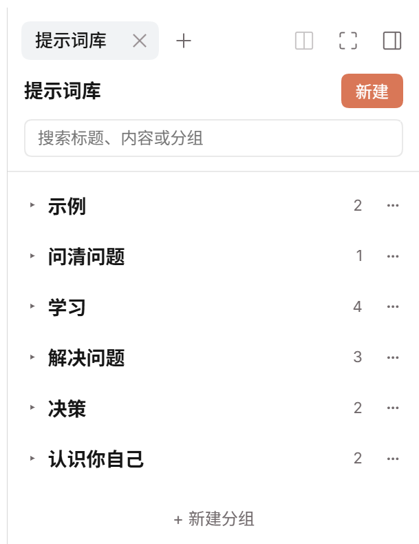
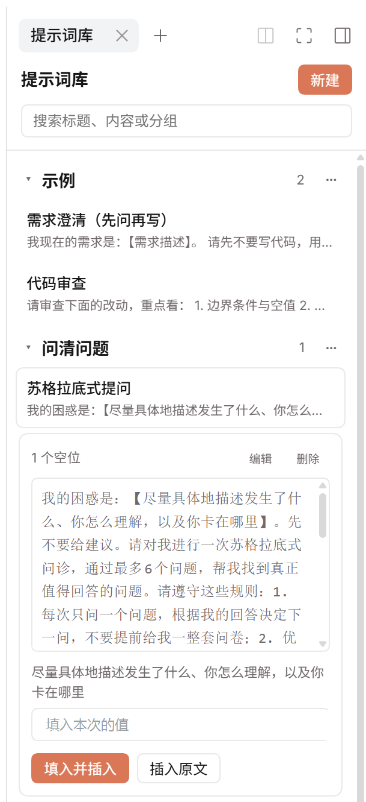

# Prompt library

[中文](README.md) | English

A right sidebar panel for the prompt templates you paste into a session over and
over: group them, search them, fold a group away, fill the blanks, insert them
into the composer — you still press send.

> This is the optional English translation. The Chinese
> [README](README.md) is the primary one.

## Requirements

- DeepSeek Harness `^0.2.3-alpha.2` (declared in `engines.dsh`).
- The plugin builds on alpha client APIs — the right sidebar tab registry
  (`ctx.sidebarRightTabs`) and the session input facade (`inputActions`). A
  newer DSH release may need a matching plugin release.

## Install

**From npm**

```sh
dsh plugin --profile desktop add @virtin37/dsh-prompt-library@latest
```

That installs the package into the profile. It does **not** enable it — do one
of these:

- open **Plugins** in DSH, find `@virtin37/dsh-prompt-library`, and flip its
  switch on;
- or tell the DSH agent: "enable @virtin37/dsh-prompt-library".

Then reload the page (or restart the desktop client once).

> Why two steps: `dsh plugin` forwards its arguments to pnpm and only changes the
> dependencies. Activation means writing the package name into the profile's
> `dsh.profile.bundles`, which today only the plugin manager (the GUI or the
> agent tool) does.

**From a local directory (development)**

1. Clone or copy this directory somewhere stable.
2. In DSH open **Plugins → Add plugin** and select the directory.
3. If the **Prompt** button does not appear, reload the page once.

## Where it lives

- **Prompt library** tab in the right sidebar. It coexists with the
  conversation, so you can read the transcript while you pick a template. It is
  also listed on the right sidebar's guide page and its add menu.
- **Prompt** button at the left of the composer tool row, next to the permission
  and model controls, opens the same tab.



## How a template works

Write the template as plain text. A fill-in spot is Chinese square brackets
around a short name:

```
请按【项目名】的既有风格改写下面这段，保持 API 签名不变：

【原文】
```

Clicking the template expands it in place. With one blank it shows the template
and that blank together. With two or more it walks them one at a time: a
progress count (`2 / 5`), the blank's name, and the surrounding sentence so you
know what is being asked. Enter advances, Enter on the last one inserts,
**Previous** and **Skip** are there when you need them, and **Show all** switches
to the flat form (then **One by one** switches back).

Every `【…】` occurrence counts, including empty brackets (`【】`, labelled
"Blank 3") and repeated names. A repeated name shares one value across its
occurrences; the later step says so. Bracket contents may be up to 200
characters on one line.

Insert pushes one undoable edit into the composer; you still press send.



## Data

Groups, templates and the last values you typed are stored in this browser's
`localStorage` under `dsh.prompt-library.v1`. They do not sync across browsers or
machines, and a different origin (for example a different port) sees a different
library. Deleting the plugin leaves the data behind but nothing reads it.

## Development

The browser half is a single plain-JavaScript module (`client.js`); there is no
build step. Edit it, then recompose the profile (toggle the plugin row, or run
`dsh` against the same profile) and the open page picks the new module up through
the client HMR channel.

```
npm test
```

runs the parsing tests in `test/slots.test.mjs` against the real `client.js` in a
`vm` context, so the tests exercise the shipped code rather than a copy.

## Known limits

- Insertion lands at the composer's current caret. With an empty draft that is
  the beginning of the message; with existing text it is where the caret sits.
- A template whose `【】` brackets are ordinary prose can be inserted with
  **Insert as written** instead of filling.
- A fill-in name must be on one line and at most 200 characters.
- No import/export yet.

## License

MIT.
