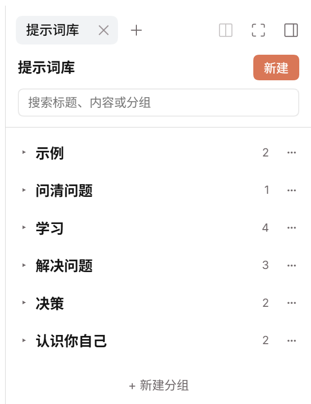
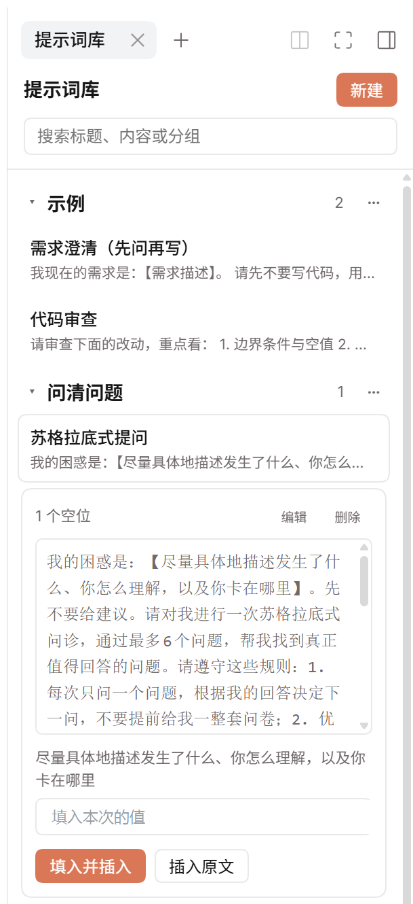

# 提示词库

中文 | [English](README.en.md)

把反复粘贴的提示词模板收进会话右侧栏：分组、搜索、折叠分组、填空，再插进输入框——发送仍然由你按。

## 环境要求

- DeepSeek Harness `^0.2.3-alpha.2`（见 `engines.dsh`）。
- 插件依赖两个 alpha 客户端接口：右侧栏标签页注册（`ctx.sidebarRightTabs`）和会话输入门面（`inputActions`）。DSH 升级后可能需要对应的插件版本。

## 安装

**方式一：npm 包**

```sh
dsh plugin --profile desktop add @virtin37/dsh-prompt-library@latest
```

这条命令只负责把包装进 profile。**还要启用**，任选一种：

- 打开 DSH 的 **插件（Plugins）** 页，找到 `@virtin37/dsh-prompt-library`，把开关打开；
- 或者对 DSH 里的 agent 说一句「启用 @virtin37/dsh-prompt-library」。

启用后刷新一次页面；桌面版也可以重启客户端。

> 为什么是两步：`dsh plugin` 只是把参数转给 pnpm，只改依赖；激活写在 profile 的 `dsh.profile.bundles` 里，这一步目前只有插件管理器（GUI 或 agent 工具）会做。

**方式二：本地目录（开发时用）**

1. clone 或复制本目录到固定位置；
2. **Plugins → Add plugin** 选中该目录；
3. 没看到「提示词」按钮就刷新一次。

## 入口

- 右侧栏的 **提示词库** 标签页。它和会话并存，可以一边看对话一边挑模板；右侧栏的引导页与加号菜单里也会列出它。
- 输入框工具行左侧的 **提示词** 按钮，打开同一个标签页。



## 模板怎么写

纯文本即可。待填的位置用中文方括号包一个短名字：

```
请按【项目名】的既有风格改写下面这段，保持 API 签名不变：

【原文】
```

点模板就地展开。只有一个空位时，模板和这个空位一起显示；两个以上时逐个提问：进度（`2 / 5`）、空位名字、以及它前后那句话，让你知道在问什么。回车走下一个，最后一个回车直接插入；还有 **上一个**、**跳过**，**全部列出** 可以切回表单视图。

每一处 `【…】` 都算一个空位，包括空括号（`【】`，显示为“空白 3”）和重复的名字。同名的空位共用一个值，走到后面时会提示。括号内的名字最长 200 字、不能跨行。

插入只是往输入框里写一次可撤销的编辑，不会发送。



## 数据

分组、模板和你上次填过的值都存在浏览器的 `localStorage` 里，键名 `dsh.prompt-library.v1`。不跨浏览器、不跨机器同步；换个端口（origin 不同）就是另一库。卸载插件不会删除这些数据，但也没有界面再读它。

## 开发

浏览器端就是单个纯 JavaScript 模块（`client.js`），没有构建步骤。改完重新组合 profile（切换一次插件开关，或用同一个 profile 跑 `dsh`），打开的页面会通过客户端 HMR 通道拿到新模块。

```
npm test
```

会在 `vm` 上下文里加载真实的 `client.js` 并测试解析逻辑，测的是发出去的代码本身，不是副本。

## 已知限制

- 插入位置是输入框当前光标处：草稿为空时就是开头，已有内容时是光标所在处。
- 模板里 `【】` 本来就是正文的话，用「插入原文」绕开填空。
- 空位名字必须单行、最多 200 字。
- 还没有导入导出。

## 许可

MIT。
